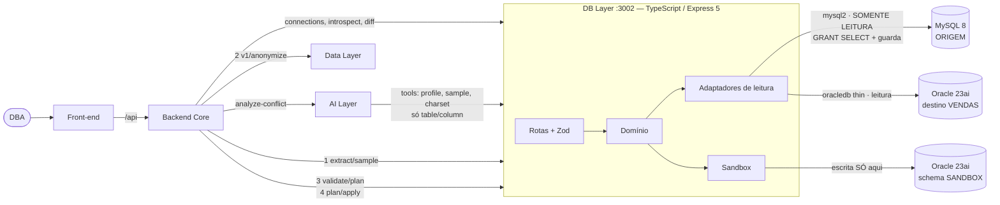
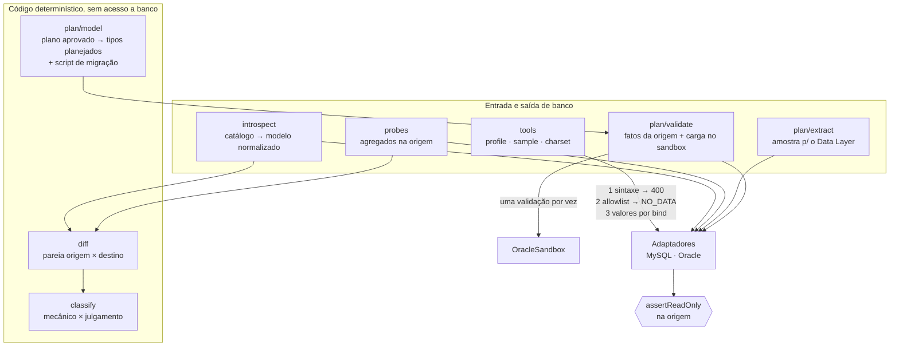

# Arquitetura — DB Layer (atualizada após a integração real)

## Visão na plataforma

Tudo roda **real** no repositório `placeholder-platform` (um `docker compose up`), com teste
ponta a ponta no CI.

## Dentro do DB Layer

### Decisões tomadas na prática

| Decisão | Por quê |
|---|---|
| `oracledb` em modo *thin* | Sem Oracle Instant Client: imagem pequena, roda igual em Windows, Linux e Mac |
| `NUMBER`/`DECIMAL`/`BIGINT` trafegam como texto, contagens convertidas na fronteira | O número do JavaScript perde precisão, e os contratos usam `number` |
| Classificador e interpretação do plano como funções puras | Testáveis com fixtures; quem valida não é quem propõe |
| Identificador validado contra o catálogo, nunca vindo pronto de fora | A IA escolhe **qual** evidência quer, nunca **como** consultar |
| Tipo planejado **reconstruído** a partir da resolução, nunca copiado | O texto vem da IA ou de um humano e vai parar num DDL |
| Mascaramento por cardinalidade no `sample-values` | Dado pessoal não sai do DB Layer em direção ao LLM |
| Validação em duas partes: fatos medidos na **origem** + carga do dataset **anonimizado** no SANDBOX | A anonimização muda o tamanho dos e-mails e perturba decimais; o truncamento tem que ser medido no dado real, e a compatibilidade de tipos no Oracle de verdade |
| Datas, ENUM e flags vão preservadas para o Data Layer | A data zero é o defeito que o sandbox precisa reproduzir; não é dado pessoal |
| Escrita **só** no schema SANDBOX, com usuário próprio (`SBX_USER ≠ TGT_USER`, checado no boot) | Validar exige carregar dados; a origem e o destino nunca são escritos |
| `/plan/apply` **gera** o script de migração e não o executa | Aplicar em produção é um passo explícito do DBA (execução assistida: Fase 7) |
| Sandbox aquecido no boot e validações serializadas | O primeiro DDL no Oracle levava ~13 s; as tabelas do sandbox têm nomes fixos |

## Como suporta crescimento

- **Novos bancos**: implementar o adaptador e a introspecção que produz `NormSchema`. Diff,
  classificador, tools e validação não mudam. O PostgreSQL é o próximo.
- **Novas regras de migração**: cada regra é um caso em `classify()` (função pura, com teste).
  Cada nova verificação de plano é um item em `validatePlan`.
- **Novos consumidores**: contrato HTTP/JSON com códigos de erro fixos (`INVALID_IDENTIFIER`,
  `EMPTY_SCHEMA`, `CONNECTION_MISMATCH`, `SANDBOX_UNAVAILABLE`...). O contrato com o Core é
  travado por teste (`tests/core-contract.test.ts`).

## Escalabilidade

- **Análise e tools não guardam estado**: dá para subir N réplicas atrás de um balanceador.
- **Validação**: uma por vez por schema SANDBOX, porque as tabelas têm nomes fixos. Para
  validar migrações em paralelo, a Fase 7 prevê um schema de sandbox por migração.
- **O trabalho pesado fica no banco**: probes e fatos da origem são agregados (`COUNT`, `MAX`,
  `SUM CASE`), e o que trafega são números. A extração para o sandbox é limitada a 1.000 linhas
  por tabela.
- **Pools**: 4 conexões por lado e 2 no sandbox, fixos no código. Quem limita o volume é o banco
  de origem.

## Manutenção

- **TypeScript estrito**, com configuração validada no boot (falha alto se faltar variável).
- **43 testes**; CI (lint, typecheck, testes, build) e publicação da imagem
  `ghcr.io/pedrolombardi/placeholder-db-layer` a cada push na `main`.
- **Reprodutível**: `docker compose up` sobe origem, destino, sandbox e o serviço sem
  configuração manual; `npm run evidencias` regera as evidências.
