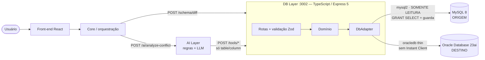
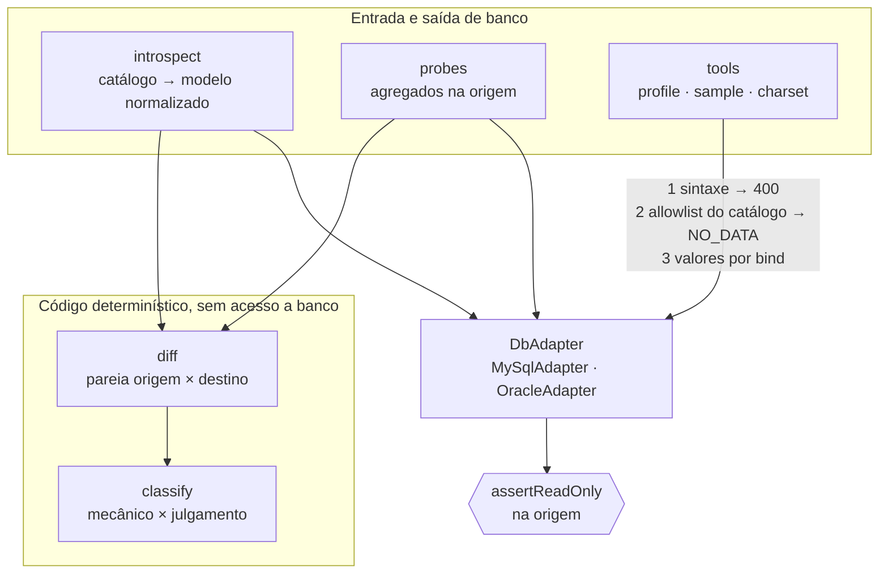

# Arquitetura — DB Layer (atualizada após a PoC)

## Visão na plataforma

Na PoC, o papel do Core é feito pelo `npm run demo`: ele chama o diff e manda cada conflito de
julgamento à AI Layer. As integrações com MySQL e Oracle são **reais** (containers
`mysql:8.0` e `gvenzl/oracle-free:23-slim`).

## Dentro do DB Layer

### Decisões tomadas na prática

| Decisão | Por quê |
|---|---|
| `oracledb` em modo *thin* | Sem Oracle Instant Client: imagem pequena, roda igual em Windows, Linux e Mac |
| `NUMBER`/`DECIMAL`/`BIGINT` trafegam como texto, contagens convertidas na fronteira | O número do JavaScript perde precisão, e o contrato com a AI Layer precisa de `number` |
| Classificador como função pura | Testável com fixtures; quem valida não é quem propõe |
| Modelo normalizado (`NormSchema`) | O domínio não conhece driver; um engine novo é só um adaptador novo |
| Identificador validado contra o catálogo, nunca vindo pronto de fora | A IA escolhe **qual** evidência quer, nunca **como** consultar |
| Mascaramento por cardinalidade no `sample-values` | Dado pessoal não sai do DB Layer em direção ao LLM |

## Como suporta crescimento

- **Novos bancos**: implementar `DbAdapter` + uma função de introspecção que produza
  `NormSchema`. O diff, o classificador e as tools não mudam. O PostgreSQL é o próximo.
- **Novas regras de migração**: cada regra é um caso em `classify()`, uma função pura com teste
  próprio. Regra nova não exige banco para ser testada.
- **Novos consumidores** (Core, Front, AI Layer): contrato HTTP/JSON estável, com códigos de
  erro fixos (`INVALID_IDENTIFIER`, `EMPTY_SCHEMA`, `NO_DATA`...).

## Escalabilidade

- **Serviço sem estado**: não guarda sessão nem resultado. Dá pra subir N réplicas atrás de um
  balanceador.
- **Pool de conexões por lado** (hoje 4, configurável). Quem limita o volume é o banco de
  origem, não o serviço. Por isso o roadmap prevê amostragem e limite de tempo nos probes.
- **O trabalho pesado fica no banco**: os probes são agregados (`COUNT`, `MAX`, `SUM CASE`), e
  o que trafega são números, não linhas.

## Manutenção

- **TypeScript estrito**, com configuração validada no boot (falha alto se faltar variável).
- **30 testes** + CI (lint, typecheck, testes e build) a cada push. O workflow que publica a
  imagem no GHCR está escrito, mas ainda não rodou (falta o repositório no GitHub).
- **Reprodutível**: `docker compose up` sobe origem, destino e serviço sem configuração manual;
  `npm run evidencias` regera as evidências.
